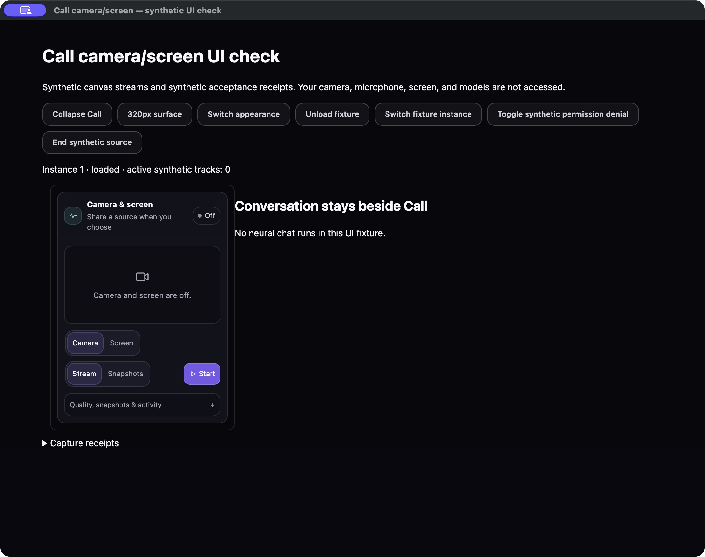
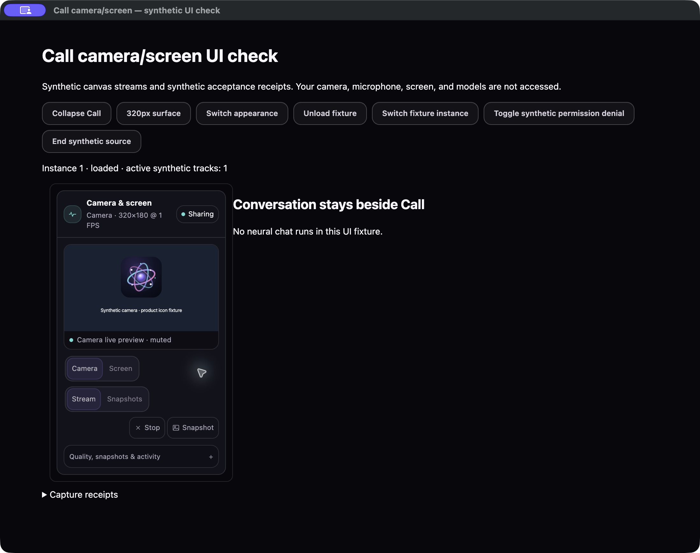
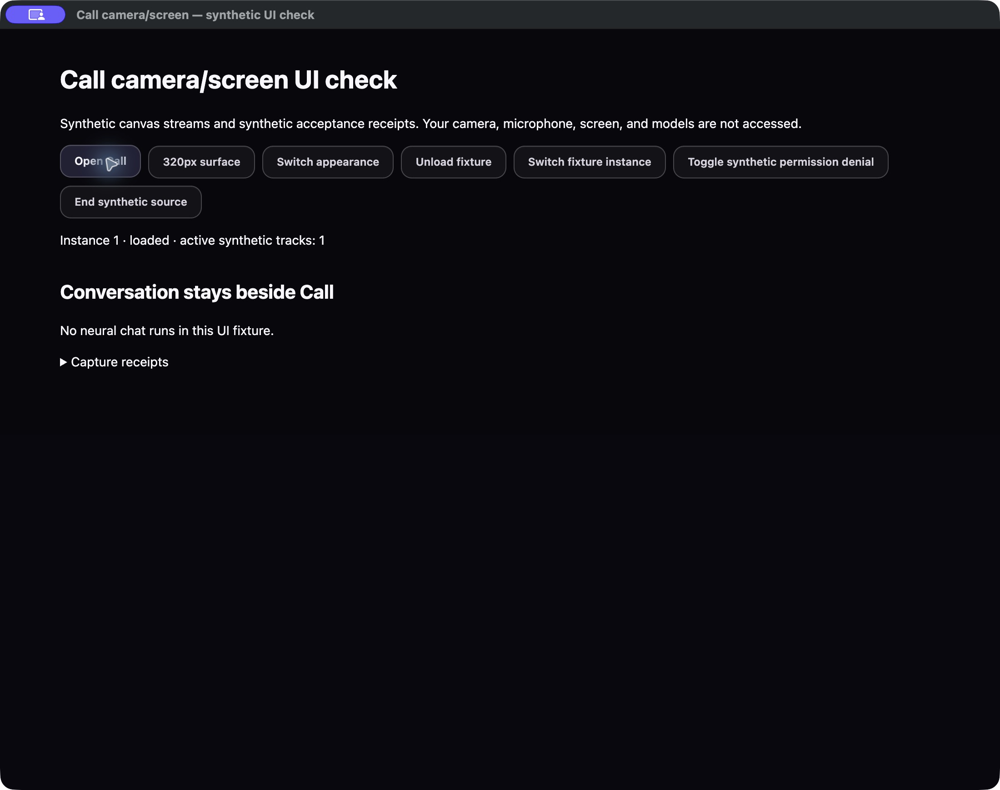
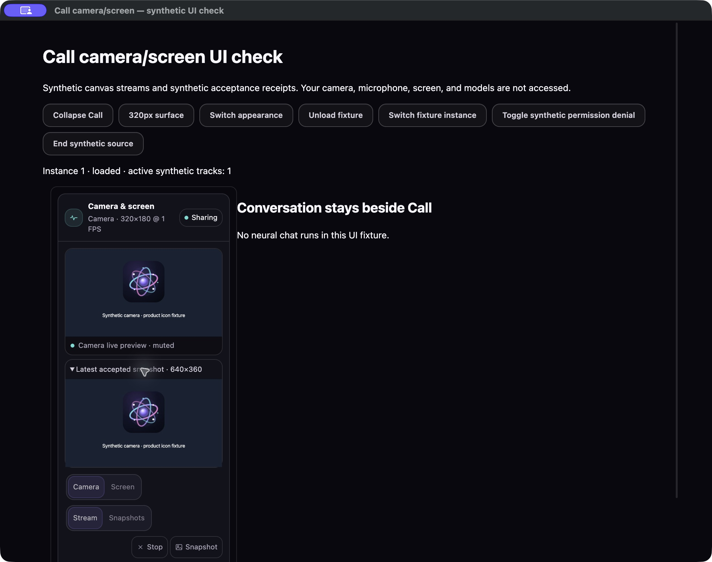
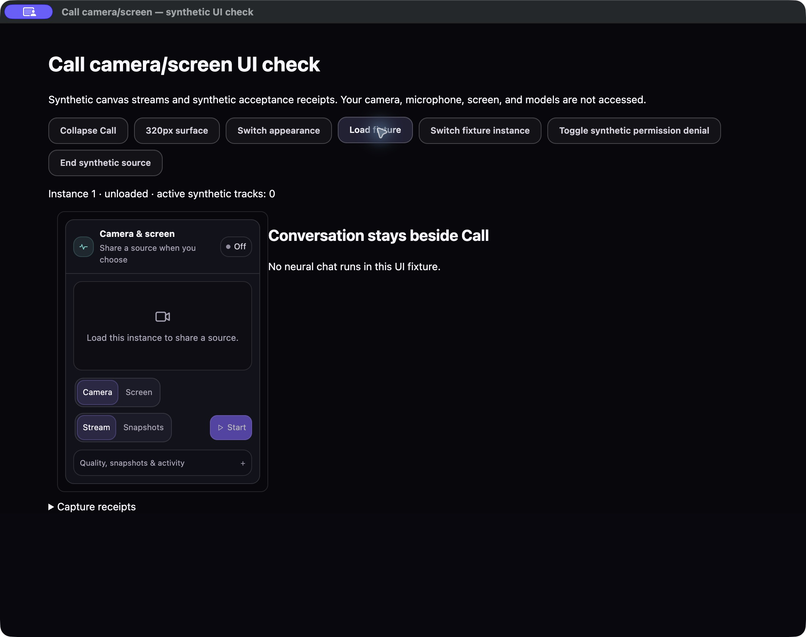
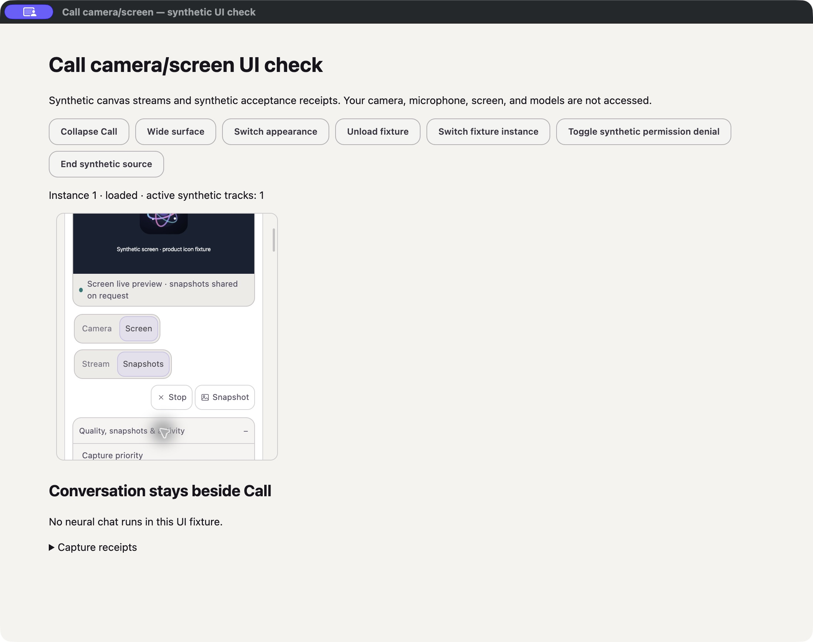
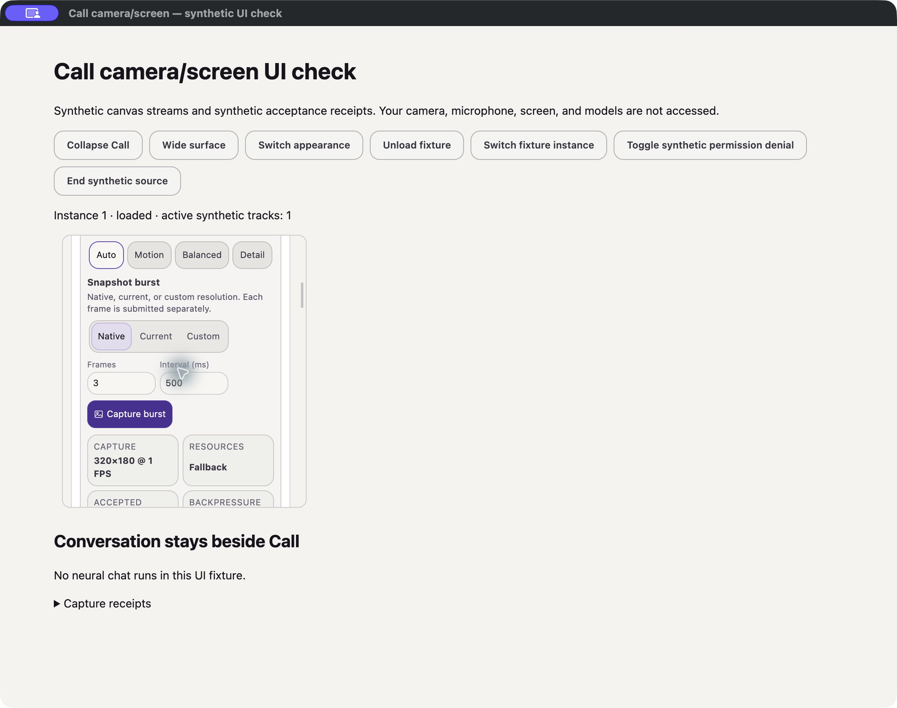
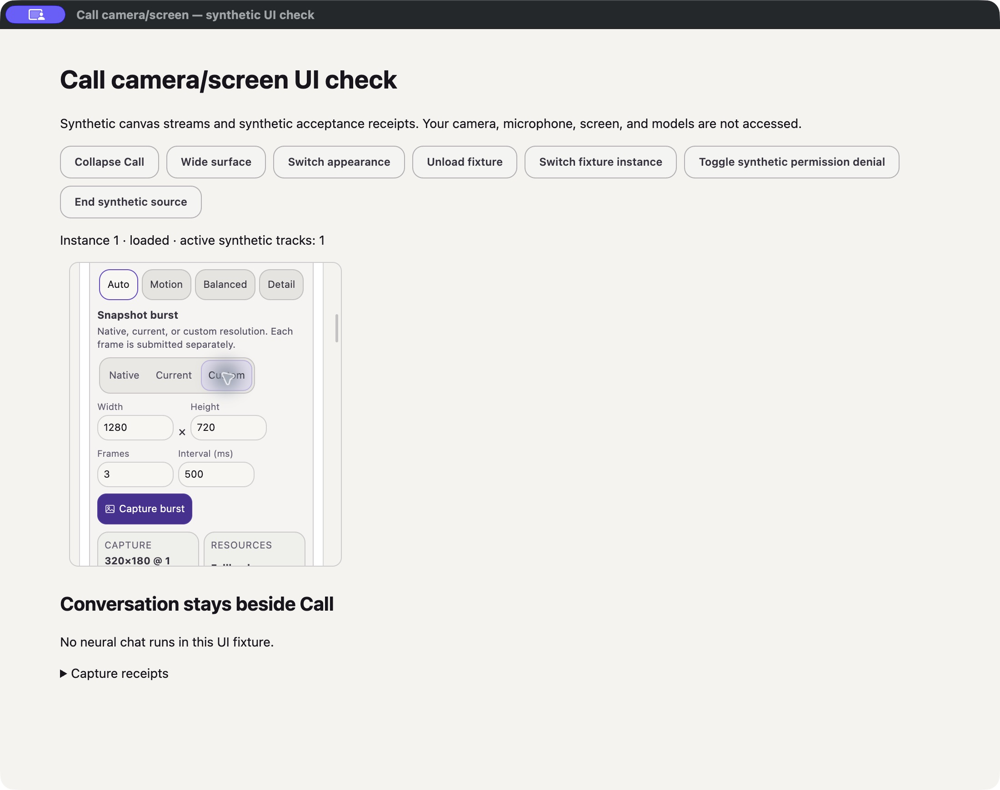
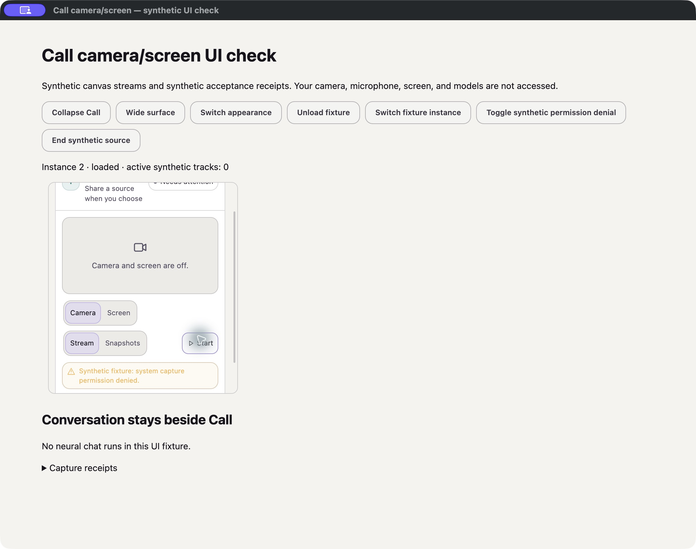
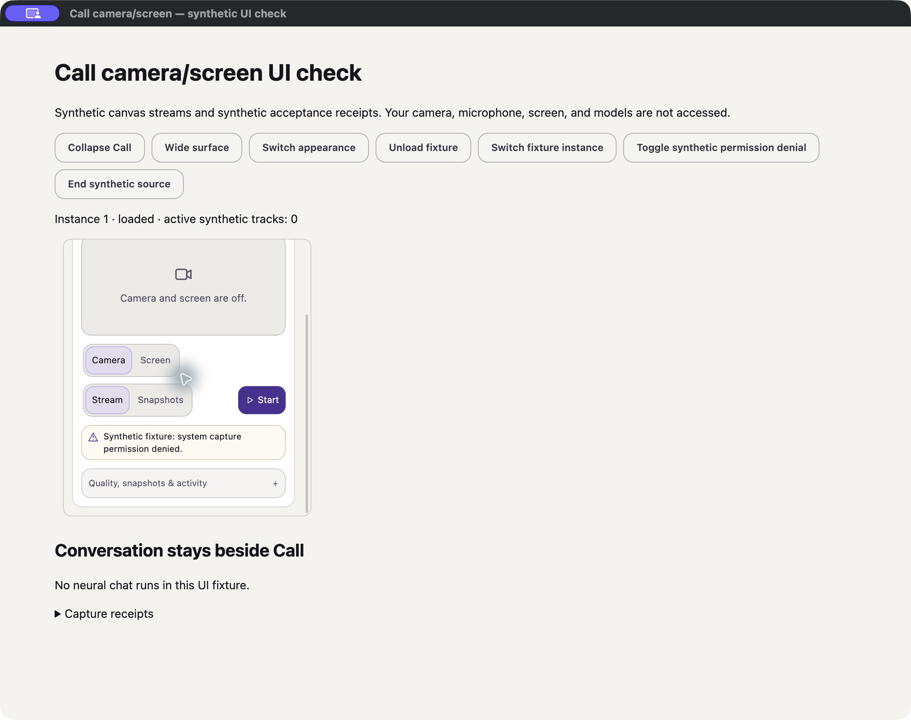

# Call: camera and screen

October 11, 2026. Source and bounded synthetic UI scope only. No camera,
microphone, screen permission, neural Load, model creation, training, corpus,
GitHub CI or release was exercised by this slice.

## User contract

PLAN's media/calls section and REQUEST_VERBATIM's Call/preview/snapshot requests
are the authority. Camera/screen sharing sits inside the existing top-level
Call beside the conversation; it is not a separate exposed Live Perception
mode. Voice controls and audio routing remain separately owned.

- Opening Call, expanding Advanced, loading an instance, or switching an
  instance does not request a source. Start is explicit and requires Load.
- Camera and Screen are separate choices. Stream sends admitted continuous
  frames; Snapshots keeps the source and local preview but starts no continuous
  packet timer. In Snapshots, only audited user/brain snapshot requests submit
  visual frames. It is not a second neural model or a prompt injection path.
- The muted preview borrows the capture handle's **existing** MediaStream. It
  never calls getUserMedia/getDisplayMedia itself or stops tracks when merely
  hidden. Collapsing Call preserves the mounted controller and session.
- Native/current/custom snapshot sizes, burst count and interval remain
  available in Advanced. The displayed still is the latest **actually
  accepted** frame, not a fabricated placeholder, extra capture, entire retained
  burst, or claim that native learning succeeded. Its object URL is revoked on
  replacement, Stop/Unload, identity change and view disposal.
- Stop ends source ownership, not learned state. Cancelling a pending permission
  request invalidates its result; a late granted stream is immediately closed
  and cannot open a neural session. A host close failure releases the local
  device and shows an error; a second explicit Stop retries host closure before
  another source can start. No successful closure is invented.
- Host session closure, external track end, Unload and panel/identity disposal
  release the owner, listeners, local preview and latest still. Returning from
  Unload requires another explicit source Start. Preview detachment alone does
  not stop a still-owned capture.

## Device-derived planning, not a product resolution ceiling

`planLivePerception` still uses the actual hardware profile, available measured
token/copy/transport rates and source-native capabilities. Auto/Motion/Balanced/
Detail have different resource allocation; explicit dimensions/FPS retain
native/resource validation. Native snapshots retain native dimensions by
spacing frames farther apart when necessary; custom requests report their
actual resource/source-bounded dimensions. The driver may negotiate less than
its advertised maxima; the UI displays actual settings, not the requested ideal.

This review found and repaired two pre-existing source problems:

1. Native negotiation converted the initial pixel budget into a **synthetic
   memory-bandwidth measurement**, often causing an unintended fallback.
   Original measured inputs now survive native negotiation; no invented
   bandwidth is supplied. The actual negotiated plan reaches controller and UI
   snapshot/control bounds instead of retaining the provisional initial plan.
2. Mode-only Motion/Detail requests previously kept the old FPS/resolution
   unless already over budget. They now replan from the same native/measured
   envelope before applying its limits, so changing priority changes capture,
   not just its label. Explicit requested operands are still honored within
   that envelope.

There is no fixed 720p/10-FPS or 320p product maximum. The 320×180/1-FPS branch
is a resource fallback, not the upper bound for all devices. Tier defaults
apply before source/measurement evidence is available; they are not a measured
performance guarantee. A constructor-only case supplies a 3840×2160/60 source
and genuine **fixture input values** for fast throughput, obtaining 4K/60; a
slow token-rate input obtains fallback. These supplied measurements are not
measurements of the user's Mac. No real-device benchmark was rerun.

## Implementation and focused checks

- `LivePerceptionPanel.tsx`: keyed per-instance owner, explicit runtime gate,
  Camera/Screen and Stream/Snapshots choices, visible Stop, compact Advanced.
- `LiveCapturePreview.tsx` / `capturePreviewOwnership.ts`: borrowed video view,
  accepted still URL lifetime, stale play-error suppression and no track-stop
  authority in the view. Primitive effect dependencies avoid reacquiring a
  source for an unrelated brain document update.
- `livePerceptionController.ts`: pending-permission fencing, idempotent owner
  close, track-ended subscription, accepted-only still publication, host-close
  cleanup, original measurement preservation and actual negotiated plan.
- `cameraScreenPanel.css`: narrow reflow, focus indicators, source/quality
  states, readable light warning text and a non-disappearing primary hover.

The affected four-file Vitest run passed **34/34 in 4.60s** after the negotiated
plan correction (19 controller, nine browser-capture, three preview-ownership,
three renderer-contract cases). Two subsequent distinct focused cases passed:
failed-host-close/explicit retry, and mode-only Motion/Detail replan. Do not add
the skipped cases in those filtered runs to the total: **36 distinct checks**.
Renderer TypeScript passed after the negotiated-plan correction. A concurrent
Node check reached one unrelated task-attachment mock typing error, which the
root owner separately repaired; that result is not reported as this lane's
full-repository verification. Whitespace checks passed. No full suite/build.

## Bounded visual audit

Capture tool: native Computer Use on the isolated Electron fixture. In-app
Browser was unavailable. Fixture media are real canvas MediaStreams showing
the repository's product icon, clearly labeled synthetic; device APIs are
substituted and the fixture main process denies real device permission. Host
acceptance receipts are synthetic. Production panel/controller/preview and
CallLayout are mounted; root's App/CallLayout source was not edited by this lane.

Every saved screenshot below was reopened and inspected from its local file.
An initial Vite refresh interrupted a continuity attempt; that attempt was
excluded. A later uninterrupted sequence proved collapse/reopen, accepted still,
Unload and identity cleanup. A subsequent refresh erased the transient fixture
receipt list; no reconstructed receipt list is presented as original evidence.

### 1. Off — healthy

Zero active tracks, explicit Start, Camera/Screen and Stream/Snapshots choices,
with conversation beside Call at wide size.

### 2. Stream — healthy in this synthetic scope

One owned synthetic camera track, real visible video pixels, actual negotiated
settings, Stop/Snapshot reachable. No second device request for preview.

### 3. Collapse/reopen — healthy

Controls hide while the active synthetic-track count stays one. Reopening
revealed the same preview; capture was not restarted.

### 4. Accepted still — healthy

The burst's actual encoded/accepted JPEG appears separately from the live view,
with its actual 640×360 dimensions. This is not neural-learning evidence.

### 5. Unload — healthy in the simulated lifecycle scope

Active tracks fall to zero; video and still disappear; Start is disabled.
Reloading the fixture did not implicitly restart capture.

### 6. Snapshot-only screen, 320px/light — healthy

Caption and controls distinguish snapshots-on-request from continuous delivery.
The Advanced readout showed zero accepted frames before any snapshot request.
The image captures a deliberate scrolled position inside the narrow Call pane.

### 7. Advanced, scrolled — healthy layout

Motion/Detail/Auto controls, resolution choices, burst/interval inputs and
capture readouts are reachable by scrolling, with no visible horizontal overlap.

### 8. Custom size — healthy layout

Width/Height and Frames/Interval inputs remain labeled and fit at 320px.
Switching the fixture instance while that source was active then released the
track, removed the prior preview, and opened the new instance with zero tracks.

### 9. Permission denial — functional; contrast defect found

Denied capture retains zero tracks and surfaces the actual supplied denial.
The original amber-on-light warning and primary hover were too faint.

### 10. Warning/hover correction — visibly repaired

The affected state alone was repeated after changing the warning to foreground
text and keeping primary hover filled. Error text and Start are now readable.
Zero active tracks remains visible; the fixture was then closed cleanly.

The audit also found stale previous-session Last control/Last snapshot fields;
new Start now clears both, covered by the affected controller case. Advanced
Current plan now describes actual capture instead of a stale pre-negotiation
sentence. The latest-still disclosure is now kept mounted while each burst
frame's object URL replaces the last, so a mid-burst update cannot discard its
expanded/focused control; that final source contract passed the affected three
renderer cases, without another live sequence. Screenshots 2–8 precede the final measurement/replan correction, so
their 320×180/1-FPS readout must not be used as the corrected planner's output or
as a performance measurement. The current planner has separate source fixtures.

## Explicit remaining acceptance boundaries

- No real camera/screen picker, macOS permission grant/revocation, Windows/Linux/
  mobile device flow, driver maxima or physical capture throughput was tested.
- The real neural observation service, parameter deltas, simultaneous native
  audio conversation and useful visual understanding were not run here.
- A custom capture adapter that cannot expose its existing MediaStream reports
  preview unavailable rather than inventing pixels. Still preview supports
  accepted JPEG/PNG/WebP only, not arbitrary active content.
- The local preview can fail autoplay/decoder setup without manufacturing a
  successful preview; its error remains visible while Stop closes the source.
- Planning uses supplied profile/measurement evidence and per-packet host
  resource/backpressure authority. This is not proof of continuous hardware
  thermal sensing or whole-device optimal FPS under changing external load.
- Only this bounded dark/wide and light/320px flow was visually inspected; not
  all themes, screen-reader behavior, keyboard order, zoom or WCAG compliance.
- No universal package/device or current neural-memory qualification is implied.
